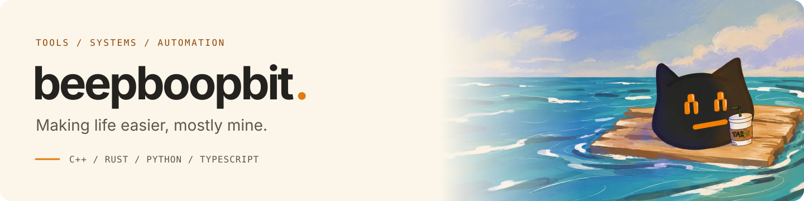

<picture>
  <source media="(prefers-color-scheme: dark)" srcset="assets/banner-dark.svg">
  <source media="(prefers-color-scheme: light)" srcset="assets/banner-light.svg">
  
</picture>

  <picture>
    <source media="(prefers-color-scheme: dark)" srcset="https://github-profile-summary-cards.vercel.app/api/cards/profile-details?username=BeepBoopBit&amp;name=BeepBoopBit&amp;theme=github_dark">
    <source media="(prefers-color-scheme: light)" srcset="https://github-profile-summary-cards.vercel.app/api/cards/profile-details?username=BeepBoopBit&amp;name=BeepBoopBit&amp;theme=github">
    
  </picture>

---

  <a href="https://beepboopbit.com">beepboopbit.com</a>

